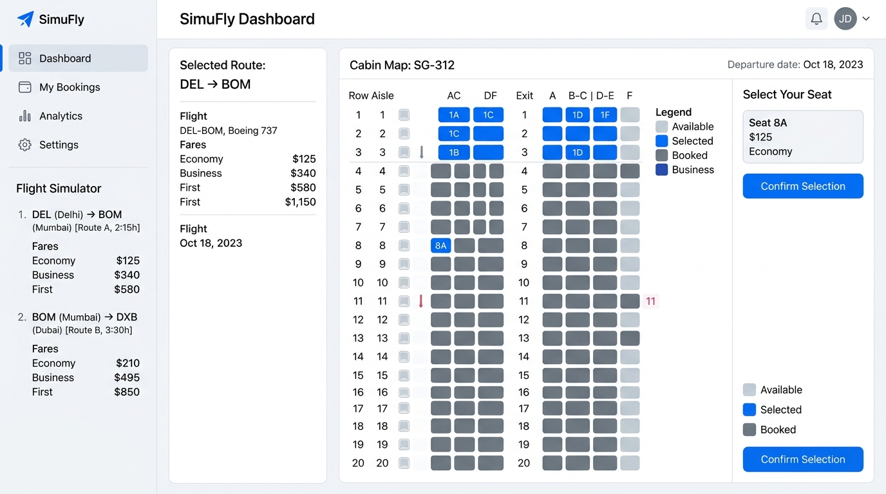
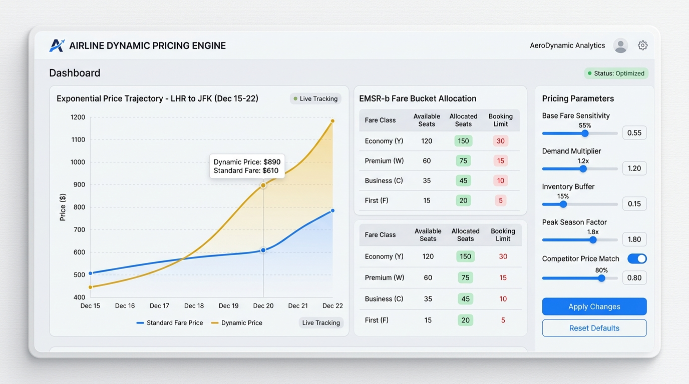
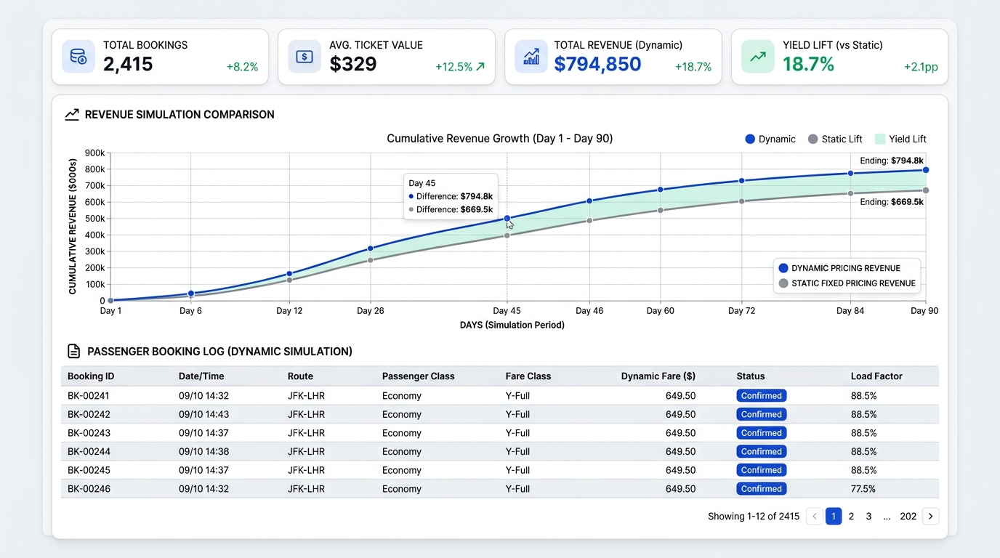

# AeroYield — Flight Booking Simulator with Dynamic Pricing Engine

A full-stack airline revenue management, seat reservation, and dynamic pricing simulator powered by **FastAPI**, **SQLAlchemy**, **scikit-learn**, **SciPy**, and **Streamlit**.

---

## Project Walkthrough & Visual Previews

### 1. Flight Booking & Interactive Cabin Seat Map
Passengers search live routes (`DEL → BOM`, `HYD → BLR`, `BOM → DXB`, `BLR → SIN`, `DEL → LHR`, `MAA → DEL`), inspect real-time dynamic fare multipliers, and select seats on an interactive 20×6 cabin map with Window (+6%) and Exit Row (+12%) surcharges. Confirming or cancelling a PNR immediately updates flight load factor and triggers live repricing across remaining seats.



---

### 2. EMSR-b Dynamic Pricing & Elasticity Laboratory
Explore how fares evolve across a 90-day booking window under Low, Nominal, and Surge demand. The engine computes **Belobaba's EMSR-b** protection levels ($\theta_j$) and booking limits across 5 nested fare buckets (`Y`, `B`, `M`, `Q`, `L`), alongside an iso-elastic demand and revenue optimization curve ($P^*$).



---

### 3. Non-Homogeneous Poisson Monte Carlo Revenue Benchmark
Simulates passenger arrivals via a **Non-Homogeneous Poisson Process (NHPP)** with log-normal willingness-to-pay over a multi-week horizon, comparing **Static Fixed Pricing** against **Dynamic EMSR-b Pricing** to quantify net Yield Lift (%), cabin load factor, and unsold seat spoilage.



---

## Key Capabilities

- **Multi-Factor Dynamic Pricing (`src/pricing_engine.py`)**: Exponential time-to-departure urgency, convex load-factor scarcity, booking velocity surge detection, competitor anchoring, and floor/ceiling guardrails.
- **EMSR-b Seat Inventory Nesting**: Normal inverse CDF (`scipy.stats.norm.ppf`) protection levels across 5 nested fare classes (`Y`, `B`, `M`, `Q`, `L`).
- **ML Demand Forecaster (`src/ml_demand_model.py`)**: `RandomForestRegressor` and `GradientBoostingRegressor` models evaluated with `RMSE`, `MAE`, `R²`, and feature importance ranking.
- **SQLite + SQLAlchemy Persistence (`src/database.py`, `src/models.py`)**: Atomic seat reservation, PNR generation, pricing history logs, and cancellation rollback.
- **Automated Test Suite (`tests/test_pricing.py`)**: `pytest` unit and FastAPI integration coverage.

---

## Architecture

```text
+-------------------------------------------------------------------+
|                  Streamlit Interactive Dashboard                   |
|   (Flight Booking | Seat Map | Pricing Lab | ML | Monte Carlo)    |
+---------------------------------+---------------------------------+
                                  | REST / JSON
                                  v
+-------------------------------------------------------------------+
|                      FastAPI Application (app.py)                  |
|  /flights   /quote   /bookings   /cancel   /ml/train   /simulate   |
+----------------+--------------------------------+-----------------+
                 |                                |
                 v                                v
+--------------------------------+  +-------------------------------+
|  Dynamic Pricing & EMSR-b Core |  |  ML Demand Model (sklearn)    |
|  - Time Decay & Load Factor    |  |  - RandomForestRegressor      |
|  - Littlewood / EMSR-b Buckets |  |  - GradientBoostingRegressor  |
|  - Elasticity & Guardrails     |  |  - Feature Importance & R2    |
+----------------+---------------+  +-------------------------------+
                 |
                 v
+-------------------------------------------------------------------+
|              SQLAlchemy ORM + SQLite (aeroyield.db)               |
|         Flights | Bookings | PricingLogs | SimulationRuns         |
+-------------------------------------------------------------------+
```

---

## Quick Start

### 1. Clone & Install
```bash
git clone https://github.com/<your-username>/aeroyield-flight-dynamic-pricing.git
cd aeroyield-flight-dynamic-pricing

python -m venv venv
# Windows: venv\Scripts\activate
# macOS / Linux: source venv/bin/activate
pip install -r requirements.txt
```

### 2. Start FastAPI Backend
```bash
uvicorn app:app --reload --port 8000
```
Open interactive Swagger API docs at `http://127.0.0.1:8000/docs`.

### 3. Start Streamlit Dashboard
```bash
streamlit run streamlit_app.py
```
Open dashboard at `http://localhost:8501`.

### 4. Run Test Suite
```bash
pytest -v
```

---

## Repository Structure

```text
aeroyield-flight-dynamic-pricing/
├── app.py                              # FastAPI REST API server
├── streamlit_app.py                    # Interactive Streamlit UI dashboard
├── requirements.txt                    # Python dependencies
├── README.md                           # Project overview & visual walkthrough
├── .gitignore
├── src/
│   ├── __init__.py
│   ├── models.py                       # SQLAlchemy ORM & Pydantic schemas
│   ├── database.py                     # SQLite engine & initial route seeder
│   ├── pricing_engine.py               # EMSR-b & multi-factor pricing core
│   ├── ml_demand_model.py              # scikit-learn demand & WTP forecaster
│   └── simulator.py                    # NHPP Monte Carlo simulation engine
├── tests/
│   └── test_pricing.py                 # Pytest unit & integration tests
└── docs/
    ├── ARCHITECTURE_AND_ALGORITHMS.md  # Mathematical specs & API reference
    └── screenshots/                    # UI explanation screenshots for GitHub
        ├── 01_flight_booking_seat_map.jpg
        ├── 02_dynamic_pricing_lab.jpg
        └── 03_monte_carlo_yield_lift.jpg
```

---

## License
MIT License
